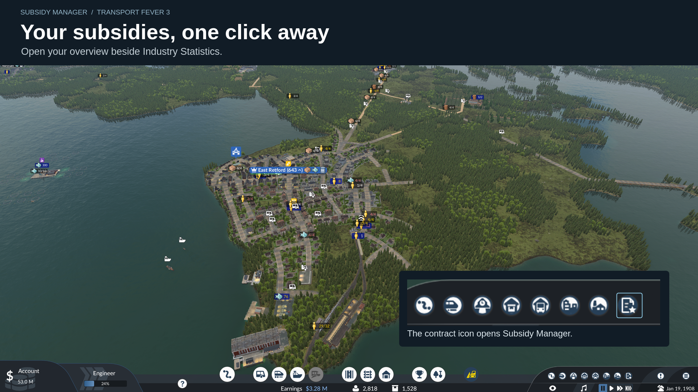
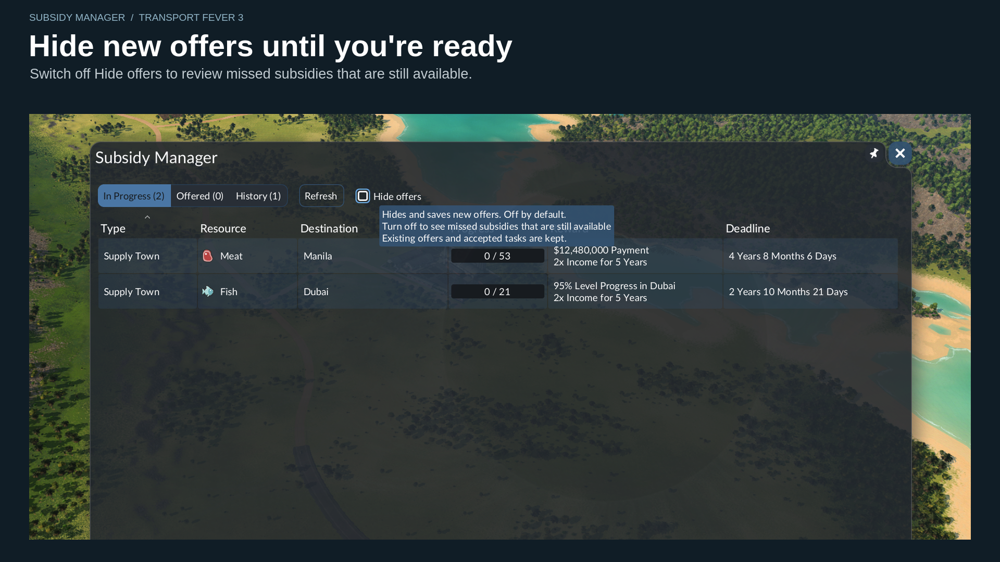
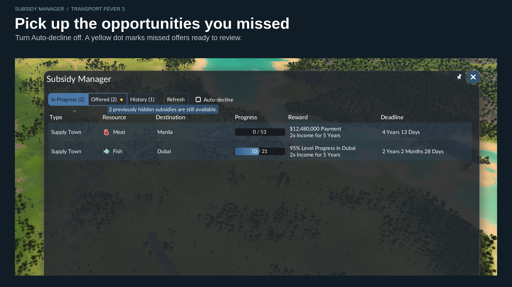
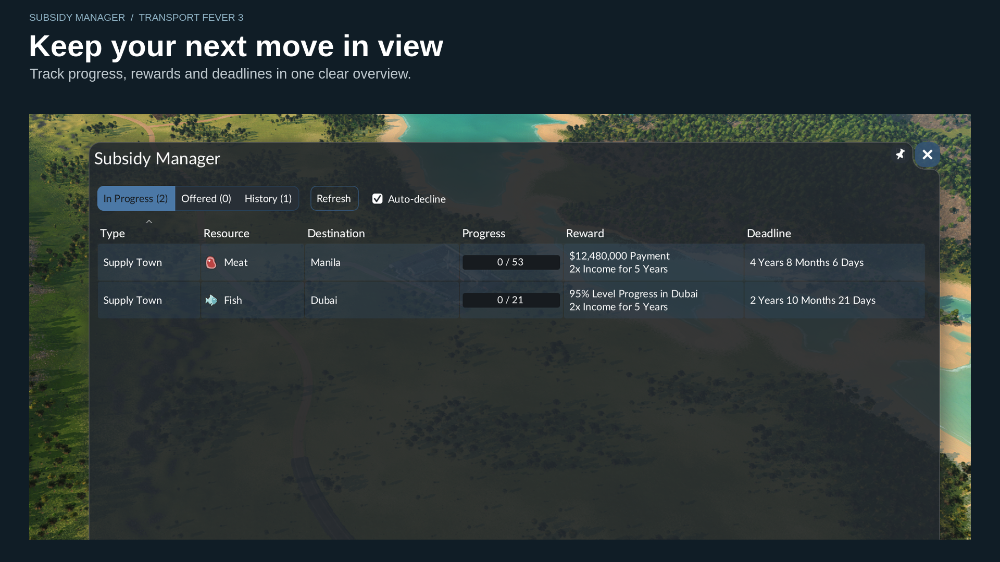
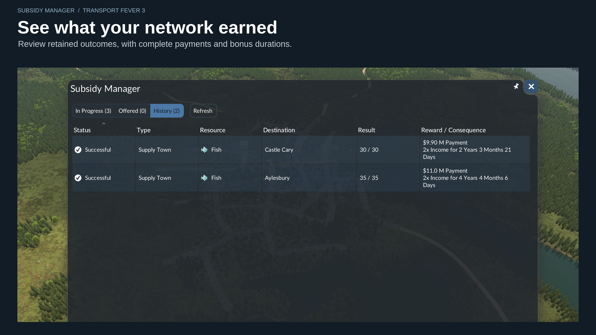
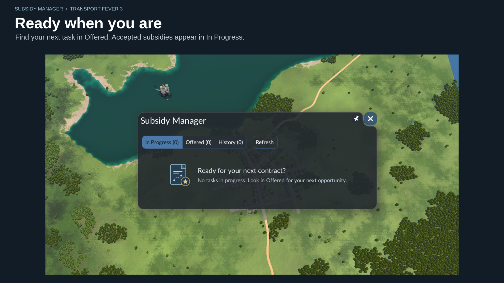
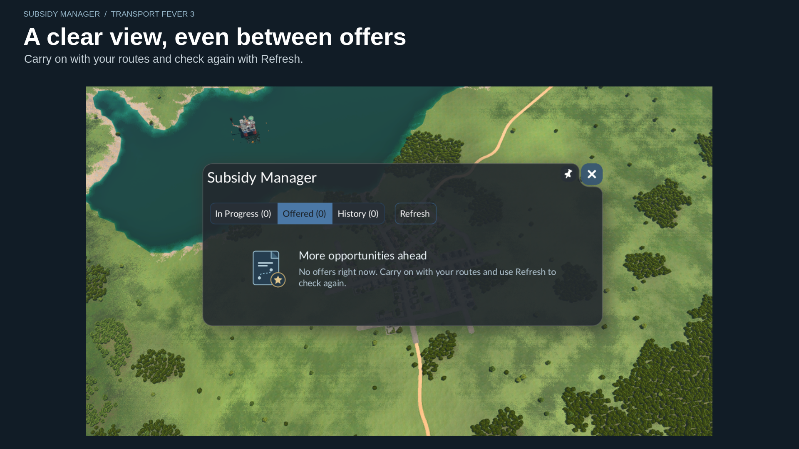
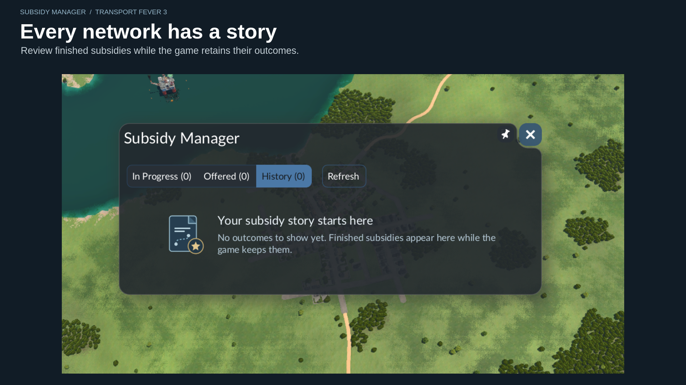

# Subsidy Manager for Transport Fever 3

A useful subsidy offer can be easy to lose in a busy game. Subsidy Manager keeps your opportunities together, so you can spend less time searching through notifications and more time planning your next route.

Compare offers, follow the tasks you've accepted, and see how your subsidies turned out—all from one window beside Industry Statistics.

## What it helps you do

- **Find your next opportunity.** Check the destination, requirements, rewards and remaining time before committing to an offer.
- **Keep your plans on track.** See progress and deadlines for the subsidies you're working on.
- **Read the whole reward.** Payments and bonuses sit on separate lines, with room for longer values and durations.
- **Go straight to the details.** Click a row to open the game's familiar subsidy window, highlight its locations, and accept or decline an offer where available.
- **Review your results.** History brings together successful and failed subsidies while the game retains them.
- **Know when something new arrives.** A small dot on the toolbar icon marks new offers since you last opened the manager.

Prefer to skip future offers? Enable **Auto-decline** in the manager. It is off by default, applies only to offers arriving after you enable it, and saves your choice for this game. Existing offers, previously revealed missed offers and accepted tasks are left alone. New offers are saved and declined in the simulation before they become available to the game’s offer notifications, without setting the manager’s toolbar dot. The option takes effect when the game confirms the change. While a subsidy action is finishing, the setting stays readable and shows **please wait**; hover for the reason.

When you switch Auto-decline off, the manager refreshes the overview automatically, checks saved offers and includes previously hidden contracts directly in **Offered**, with its count updated. The **yellow dot on the toolbar icon** also lights when missed offers become available; opening the manager clears it. A **yellow dot on Offered** marks hidden offers waiting for review; hover to see how many are still available. Opening Offered clears the dot. Use **Show declined** to include manual declines too. Click an offer to open the game’s usual details, then choose Accept or Decline as normal.

Recovery keeps the original requirements and rewards. The remaining offer timer pauses while a contract is saved and resumes when recovered; the deadline for an accepted task is unchanged. Saved offers belong to this save. An offer that is no longer valid appears in History as **Expired**, with a reason and no task-failure penalty. Temporary read errors leave it saved and offer **Try again**.

Recovery covers TF3’s four vanilla subsidy types. It can only recover offers saved by this version onward, and it cannot recover a contract whose referenced destination is no longer valid.

## Getting started

**From Mod Hub:** Find **Subsidy Manager**, subscribe, and enable it for your save.

**From a release ZIP:** Extract the `tf3_subsidy_manager_1` folder into the `mods` directory in your TF3 user-data folder, then enable it for your save.

Once your save is loaded:

1. Click the **contract icon** in the bottom-right toolbar, beside Industry Statistics.
2. Choose **Offered** for new contracts, **In Progress** for accepted tasks, or **History** for past outcomes.
3. Click a subsidy to open its details. The game's usual controls handle acceptance and decline.
4. When Auto-decline is off, hidden offers appear directly in **Offered**. Enable **Show declined** to include manual declines. Click a subsidy to open its usual details and choose Accept or Decline.
5. Press **Refresh** whenever you want to bring the overview up to date, including after accepting a subsidy while paused.

You can move and pin the window. When there are no subsidies in any section, it uses a compact layout with a friendly hint. There is no default keyboard shortcut.

## Screenshot gallery

The gallery below uses real game captures. The cover above is promotional artwork.

### Your subsidies, one click away

### Skip new offers when you want to

### Pick up the opportunities you missed

### Keep your next move in view

### See what your network earned

<strong>A clear view, even when a section is empty</strong>

Each section has its own guidance, with a compact window when the entire overview is empty.

## What's new in v1.3.0

Quietly save hidden offers, review them when you resume the subsidy flow, and recover original contracts if you change your mind. Offered can include saved manual declines, and History explains unsuccessful recoveries. See the [changelog](CHANGELOG.md) for the release history.

## What's new in v1.2.0

An optional **Auto-decline new offers** toggle, with a tooltip and a saved per-game preference. The Mod Hub description now includes notable recent changes, including clearer History, more reliable progress reads, wrapped rewards and illustrated empty views.

## What's new in v1.1.2

Clearer History with one status per outcome, explanatory tooltips for missing values, and more reliable progress and reward reads. Genuine zero worker progress appears as “0% Workers”. See the [changelog](CHANGELOG.md) for the release history.

## A few things to know

- **Switching Auto-decline off refreshes the overview automatically.** Use Refresh for other updates while the window is open. The toolbar dot does not refresh the table.
- **Task history is kept by the game.** Older outcomes can disappear when TF3 removes them. Saved declines and unsuccessful recoveries are stored separately by this mod for the save.
- **Worker progress is a native workforce boost percentage.** Zero is shown as “0% Workers” when supplied by the game; it is not a cumulative passenger count.
- **Some fields may be unavailable.** Open the game's detail window for the full task information.
- **English is currently the supplied language.**

Real-save testing on Linux covers the In Progress and History tables and all three compact empty views. The updated captures show Auto-decline guidance and the missed-offer count and yellow Offered dot. Accepted-task progress and its native notification continued during suppression in the maintainer's test. Recovery and toolbar-dot testing are still in progress. Gameplay testing on Windows, macOS, Xbox and PlayStation has not been performed. Mods that change the same toolbar or subsidy interface may conflict.

## Feedback

Found a problem or have an idea? [Open a GitHub issue](https://github.com/Ashcutus/Transport-Fever-3-Subsidy-Tracker/issues). Tell us your mod version, TF3 version and platform, and include a screenshot or error log if it helps explain what happened.

## Credits and licence

Created by **Ashcutus**. Transport Fever 3 is developed by Urban Games; Subsidy Manager is an independent community mod.

Licensed under the [MIT License](LICENSE). You may use, modify and redistribute it under the standard MIT terms.
